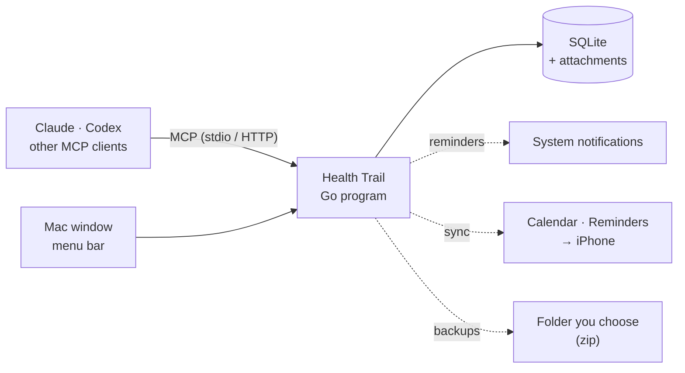

<div align="center">

[中文](README.md) | **English**


# 健康足迹 · Health Trail

### Your health records, kept on your own computer.

**Medical history, lab reports, medications, body metrics and daily check-ins, all in one place.**<br>
Let Claude or Codex enter and analyze them for you. Your data never leaves your Mac.

[](https://github.com/chunbin1/health-trail/releases) [](https://github.com/chunbin1/health-trail/actions/workflows/ci.yml) [](LICENSE)<br>
  

**[Download](https://github.com/chunbin1/health-trail/releases)** &nbsp;·&nbsp; **[Connect your AI](#connect-your-ai)** &nbsp;·&nbsp; **[Build from source](#build-from-source)**

<br>

<picture>
  <source media="(prefers-color-scheme: dark)" srcset="docs/img/overview-dark.png">
  
</picture>

<sub>The screenshots show the Chinese interface with made-up sample data. The app can also be switched to English.</sub>

</div>

<br>

## Is it for you?

Lab reports sit in your photo library, medical records in a hospital app, you rely on memory for when you took your pills, and at a follow-up you can't recall what your last result was. Health Trail puts all of this in a local database and hands it to an AI you trust to help keep it in order:

- **Snap a photo to log it**: send a screenshot of a lab report to Claude and it enters every item, flags what's high or low, and saves the original image as an attachment.
- **Ask about trends any time**: "How has my uric acid changed over the last two years?" "Has my CRP come down?" The AI answers from your data, not from guesses.
- **Reminders on time**: for medications, check-ins and follow-ups, your Mac shows a notification, and they can sync to the Calendar and Reminders apps on your iPhone.
- **Data stays on your Mac**: one SQLite file plus an attachments folder, backed up to a place you choose.

It's for people who want to manage their own (or their family's) health records seriously but don't want to hand medical records to a cloud service. If you only need to track steps and sleep, the Health app built into your iPhone is enough.

For now it supports macOS 13 and later only, on both Apple silicon and Intel.

## Quick start

**1 · Install**: download `HealthTrail-<version>.dmg` from **[Releases](https://github.com/chunbin1/health-trail/releases)**, open it, and drag 健康足迹 (Health Trail) into Applications.

<sub>The dmg is signed with a Developer ID and notarized by Apple, so it opens with a double-click. You can also [build from source](#build-from-source). When a new version comes out, the app tells you in Settings → Software update, and one click updates it.</sub>

**2 · Connect AI**: open the app's Connect AI page. Use an API for the assistant in the window (address, key and model), or use MCP and copy the configuration for the AI you use (Claude Desktop, Claude Code, Codex, or any other AI that supports MCP).

**3 · Start using it**: say to the AI

```text
Enter this lab report            (attach the screenshot)
I took my medication this morning
Help me list the questions to ask the doctor at this follow-up
```

## What it does

### Records

| Type | What it records |
| :-- | :-- |
| **Health issues** | Illnesses you're dealing with, allergies, chronic conditions; symptoms, visits and medications can all be filed under one |
| **Symptoms** | When, where, how severe |
| **Visits** | Hospital, department, doctor, diagnosis, doctor's advice |
| **Medications** | Dose, frequency, the times of day you take it; tap once to log a dose, and the pill count adds up automatically |
| **Reports** | Checkups, lab tests, imaging; each lab result is saved individually with its reference range as printed, and you can see the trend of any single result |
| **Body metrics** | Weight, blood pressure, blood glucose, or any metric you add yourself; a metric named like a lab test (such as uric acid) also shows that test's results from your lab reports; log your height once and BMI is worked out from every weigh-in; metrics can be dragged into order, and ones you rarely use left off the page |
| **Appointments** | Follow-ups and tests, with the place and what to prepare (fasting, bring your last scans) |
| **Check-ins** | "Weigh in after waking up", "Keep to my sleep schedule", with streaks and completion rates |

Reports, prescriptions and scans can be stored as attachments under the matching record, and opened with a click in the window.

<table>
<tr>
<td width="50%">
<picture>
  <source media="(prefers-color-scheme: dark)" srcset="docs/img/trend-dark.png">
  
</picture>
</td>
<td width="50%">
<picture>
  <source media="(prefers-color-scheme: dark)" srcset="docs/img/metrics-dark.png">
  
</picture>
</td>
</tr>
</table>

### Reminders and syncing to iPhone

| | |
| :-- | :-- |
| **Medications** | Reminds you if a dose hasn't been logged by the set time; no reminder if you already took and logged it |
| **Check-ins** | Reminds you if a check-in isn't checked off by its reminder time |
| **Appointments** | One reminder at 8 PM the evening before and one before it starts (1 hour by default) |
| **iPhone** | Appointments go into Calendar and medications into Reminders, synced to your phone and watch via iCloud; tick off a medication reminder on your iPhone and the app logs a dose |

When you close the window, the app keeps running in the menu bar, so reminders and automatic backups carry on; it can also open at login. Calendar entries carry a `healthtrail://` link that takes you back to that record in the app with one click.

<picture>
  <source media="(prefers-color-scheme: dark)" srcset="docs/img/checkins-dark.png">
  
</picture>

### Backups

Pick a folder (iCloud Drive or an external drive is a good choice). Each backup is a zip containing the database and attachments, and the most recent 30 are kept by default. Backups can run automatically daily, weekly, after changes, or on quit; click Restore in the list to go back to that point in time. Your current data is saved separately before a restore.

### Chinese and English

The interface can switch between Chinese and English; your data is always stored exactly as entered.

## Connect your AI

Health Trail connects to AI through [MCP](https://modelcontextprotocol.io): 15 tools (querying, entering records, importing lab reports, trends, check-ins, attachments and more), plus 5 analysis templates. The app's Connect AI page shows configurations with the current program path filled in, ready to copy.

<details open>
<summary><b>Claude Desktop</b> (Settings → Developer → Edit Config)</summary>

```json
{
  "mcpServers": {
    "health-trail": { "command": "/Applications/健康足迹.app/Contents/MacOS/health-trail", "args": ["mcp"] }
  }
}
```

After editing, quit Claude completely with ⌘Q and open it again.

</details>

<details>
<summary><b>Claude Code</b></summary>

```bash
claude mcp add health-trail -s user -- "/Applications/健康足迹.app/Contents/MacOS/health-trail" mcp
```

</details>

<details>
<summary><b>Codex</b> (shared by the CLI and the editor extension)</summary>

```bash
codex mcp add health-trail -- "/Applications/健康足迹.app/Contents/MacOS/health-trail" mcp
```

</details>

<details>
<summary><b>Other AIs that support MCP</b> (Cursor, Cherry Studio and others)</summary>

Add a stdio MCP server: set the command to the program path above and the argument to `mcp`. Or use the HTTP address `http://127.0.0.1:8721/mcp`; this way the app needs to be open.

</details>

**Analysis templates** (pick one from the "+" menu in Claude Desktop; they appear under their Chinese names):

| Template | What it does |
| :-- | :-- |
| **Review the latest lab report** (解读最近的化验单) | Which results are abnormal, how they changed since last time, what to ask the doctor |
| **Prepare a visit summary** (整理就诊摘要) | Turns a period's symptoms, tests and medications into a summary for your doctor |
| **Analyze a symptom** (分析症状) | Patterns in when a symptom appears, and records that may be related |
| **Overall health review** (健康状况总评) | An overview of all current health issues, results and medications |
| **Check-in review** (打卡复盘) | How your check-ins went and how they're trending |

The AI only speaks from your data, and suggests seeing a doctor when something looks abnormal. **Its analysis is no substitute for a doctor's diagnosis.**

### AI assistant

When you don't want to open another AI, use AI assistant in the sidebar (Today has an entry too). Once the service is filled in, a floating button also sits at the lower right and opens the same chat from any page. You can ask about the reports and symptoms already on file, or type, speak, or send a photo of a lab report or prescription so that what you want recorded becomes records — symptoms, medications, check-ins, lab reports and so on. Asked what might be wrong, it gives a diagnosis from the symptoms, lab results and reports on file, and can suggest medicines to consider. Every such answer says the result is for reference only and that you need to go to a hospital for a doctor to confirm it. When you ask what might be wrong, that diagnosis is also drafted as a health issue with status Monitoring, and the notes name the records it used and that a doctor must confirm it. It is not saved automatically; you read it and save it yourself. Asking for a medicine or a recommendation does not save another health issue, and a name already on file is not written again. A suggested medicine is also listed as a medication with status Planned, and the notes say a doctor must confirm it and that it has not been started. A name already on file is not written again. That medication is not saved automatically; you save it yourself. A suggested test or repeat test stays in the answer and is not saved as an appointment. Automatic saving is on for everything else: it is written into your records as soon as the reply arrives, and you can switch to saving by hand from the left of the message box. An entry that has a problem is not written automatically; you fix it and save it yourself.

Speech uses the Mac's own dictation, so the audio is not uploaded. Text and pictures are sent to the service you configured, along with the names of existing health issues, medications and check-ins. The service must speak OpenAI-style Chat Completions (pictures need a model that can see them). You set the address, key and model name at the top of Connect AI, or in AI assistant or in Settings. The key stays on this computer and is not included in backups. Each conversation is kept in `chats.json` in the data folder; History in the assistant opens an earlier one. Each exchange with that service is appended to `assistant.log` in the data folder (the prompt, the reply and the token counts; not the key, and pictures only as type and size). Opening `serve` in a browser can type and send pictures; dictation is only in the Mac window.

**What it writes down is no substitute for a doctor's diagnosis.**

## How it works



A single Go program provides the window (Wails v3, the system WebView + React), the local server (`127.0.0.1:8721`) and MCP. When an AI connects over stdio, it starts its own copy of the program each time, which reads and writes the same data folder as the window.

## Privacy and security

- **Your data stays on your computer**: by default in `~/Library/Application Support/HealthVault`; you can move it with the `-data` flag or the `HEALTH_TRAIL_DATA` environment variable. The app collects no usage statistics. It connects to the network in two cases: checking GitHub for a new version every few hours and when the window comes to the front, if the last check was over half an hour ago (it only asks for the version number, and you can turn this off in Settings → Software update); and the service you fill in for AI assistant. Organizing a note sends that text and the names of a few existing records to that service. Speech is recognized on the Mac and is not uploaded. The key is stored in `assistant.json` in the data folder and is not included in backups.
- **The AI sees the records it reads**: when an AI reads records, their content is sent to its provider for processing (Claude to Anthropic, Codex to OpenAI). Which AI you use and what you let it read is up to you.
- **The local server is open to this Mac only**: by default it listens only on `127.0.0.1`; other websites in your browser can't read or write your data, and the server rejects DNS rebinding and cross-site requests.
- **Attachments never run as web pages**: only images, PDFs and plain text open directly in the page; every other type is returned as a download.
- **What the AI can store as attachments is limited too**: only images, PDFs, Word/Excel files, DICOM scans, video and audio recordings. It won't store plain text (so no one can trick the AI into filing text such as keys into your records), won't read hidden files or files in Library, and leaves file paths out of its error messages.

## Command line

```bash
./health-trail              # Open the window (also serves locally at 127.0.0.1:8721)
./health-trail serve        # Run only the server, no window (e.g. on an always-on Mac mini)
./health-trail mcp          # MCP stdio mode, for AI clients
./health-trail info         # Show the data folder and the configuration for connecting AI
```

## Build from source

Requires Go 1.27+, Node 24+ and the Xcode Command Line Tools.

```bash
make app      # Build 健康足迹.app; drag it into Applications
make bin      # Build only the command-line program ./health-trail
make test     # go vet, go test, frontend type check
make dmg      # dmg for both Apple silicon and Intel (signed with a Developer ID for releases)
```

For development, use `make dev`: the UI runs at http://localhost:5173 and frontend changes take effect as soon as you save; the backend runs at `127.0.0.1:8722` and recompiles and restarts automatically when a `.go` file changes. Data comes from the test data in `~/Library/Application Support/HealthTrail-Test` (the test window from `make test-window` uses it too), so your real data is never touched.

To debug while using your own real data, use `make dev-real`: before each start it backs up the database and attachments to `~/Library/Application Support/HealthVault-dev-backups/<time>`, keeping the most recent 10.

The code structure and coding conventions are in [CLAUDE.md](CLAUDE.md) (Chinese), and pitfalls we've hit are recorded in [LESSONS.md](LESSONS.md) (Chinese). Every push runs the tests, packaging and the MCP end-to-end test in [CI](.github/workflows/ci.yml); pushing a `v*` tag signs, notarizes and publishes a release automatically, see [RELEASING.md](RELEASING.md) (Chinese).

## Roadmap

- Access from a phone browser (already built, temporarily turned off; will open once it's polished)
- Access from AI apps on the phone (Claude, ChatGPT): needs a public tunnel and OAuth sign-in
- Ask Claude directly inside the app
- Import data from Apple Health
- Data encryption
- A Windows version

## License

[MIT](LICENSE)
