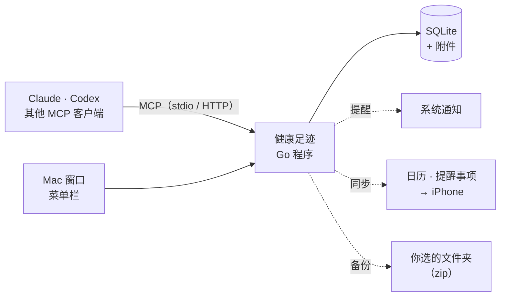

<div align="center">

**中文** | [English](README.en.md)


# 健康足迹 · Health Trail

### 你的健康档案，存在你自己的电脑上。

**病历、化验单、用药、身体数据、每日打卡，一个地方记全。**<br>
让 Claude、Codex 帮你录入和分析，数据从不离开你的 Mac。

[](https://github.com/chunbin1/health-trail/releases) [](https://github.com/chunbin1/health-trail/actions/workflows/ci.yml) [](LICENSE)<br>
  

**[下载](https://github.com/chunbin1/health-trail/releases)** &nbsp;·&nbsp; **[接入 AI](#接入-ai)** &nbsp;·&nbsp; **[从源码构建](#从源码构建)** &nbsp;·&nbsp; **[发布新版本](RELEASING.md)**

<br>

<picture>
  <source media="(prefers-color-scheme: dark)" srcset="docs/img/overview-dark.png">
  
</picture>

<sub>截图里都是虚构的示例数据。</sub>

</div>

<br>

## 适合你吗？

化验单在相册里，病历在医院 App 里，药什么时候吃的靠记性，复诊时说不清上次的指标是多少。健康足迹把这些放进一个本地的数据库，再交给你信任的 AI 帮忙整理：

- **拍照就能录**：把化验单截图发给 Claude，它逐项录进去，偏高偏低自动标出来，原图也存成附件。
- **随时问趋势**：「我近两年的尿酸怎么变化的？」「CRP 降下来了吗？」AI 从你的数据里回答，不靠猜。
- **到点提醒**：吃药、打卡、复诊，Mac 弹通知，也能同步到 iPhone 的「日历」和「提醒事项」。
- **数据只在本机**：一个 SQLite 文件加一个附件目录，备份到你自己选的地方。

适合想认真管理自己（或家人）健康记录、又不想把病历交给云服务的人。如果你只需要记步数和睡眠，iPhone 自带的「健康」就够了。

目前只支持 macOS 13 及以上，Apple 芯片和 Intel 都可以。

## 快速开始

**1 · 安装**：从 **[Releases](https://github.com/chunbin1/health-trail/releases)** 下载 `HealthTrail-<版本>.dmg`，打开后把「健康足迹」拖进「应用程序」。

<sub>dmg 用 Developer ID 签名并经过苹果公证，双击就能打开。也可以[从源码构建](#从源码构建)。以后有新版本，App 会在「设置 → 软件更新」里提示，点一下就更新。</sub>

**2 · 连接 AI**：打开 App 的「连接 AI」页，按你用的 AI 复制配置（Claude 桌面版、Claude Code、Codex 或其他支持 MCP 的 AI）。

**3 · 开始用**：对 AI 说

```text
把这张化验单录进去            （附上截图）
今天早上吃过药了
帮我整理一下这次复诊要问医生的问题
```

## 能做什么

### 记录

| 类型 | 记什么 |
| :-- | :-- |
| **健康问题** | 正在处理的病、过敏、慢性病，症状、就诊、用药都可以挂在它下面 |
| **症状** | 什么时候、哪里、多严重 |
| **就诊** | 医院、科室、医生、诊断、医嘱 |
| **用药** | 剂量、频次、每天几点吃；点一下记「吃过了」，自动统计吃了多少颗 |
| **检查报告** | 体检、化验、影像；化验指标逐项保存，参考范围原样记录，可以看单项趋势 |
| **身体数据** | 体重、血压、血糖，或者任何你自己加的指标 |
| **预约** | 复诊、检查，地点和要准备的东西（空腹、带上次的片子） |
| **打卡** | 「晨起称体重」「作息守住」，连续天数和完成率 |

报告单、处方、片子可以作为附件存在对应的记录下，在窗口里点开就看。

<table>
<tr>
<td width="50%">
<picture>
  <source media="(prefers-color-scheme: dark)" srcset="docs/img/trend-dark.png">
  
</picture>
</td>
<td width="50%">
<picture>
  <source media="(prefers-color-scheme: dark)" srcset="docs/img/metrics-dark.png">
  
</picture>
</td>
</tr>
</table>

### 提醒和同步到 iPhone

| | |
| :-- | :-- |
| **吃药** | 到了设定的时刻还没记吃药就提醒；提前吃过、记过就不提醒 |
| **打卡** | 到了提醒时间还没打卡就提醒 |
| **预约** | 前一天晚上 8 点和开始前（默认 1 小时）各提醒一次 |
| **iPhone** | 预约写进「日历」、吃药写进「提醒事项」，用 iCloud 同步到手机和手表；在 iPhone 上勾掉吃药提醒，App 里就记一次吃药 |

关掉窗口后 App 留在菜单栏继续运行，提醒和自动备份照常；也可以设成开机自动启动。日历里的条目带着 `healthtrail://` 链接，点一下就回到 App 里那条记录。

<picture>
  <source media="(prefers-color-scheme: dark)" srcset="docs/img/checkins-dark.png">
  
</picture>

### 备份

选一个文件夹（建议 iCloud 云盘或移动硬盘），每次备份是一个包含数据库和附件的 zip，默认保留最近 30 份。可以每天、每周、有改动后、退出时自动备份；在列表里点「恢复」就回到那个时间点，恢复前会先把当前数据另存一份。

### 中文和英文

界面可以切换中英文；数据始终按原样保存。

## 接入 AI

健康足迹通过 [MCP](https://modelcontextprotocol.io) 接入 AI：15 个工具（查询、录入、化验单导入、趋势、打卡、附件等），加 5 个分析模板。App 的「连接 AI」页会显示带着当前程序路径的配置，可以直接复制。

<details open>
<summary><b>Claude 桌面版</b>（设置 → 开发者 → 编辑配置）</summary>

```json
{
  "mcpServers": {
    "health-trail": { "command": "/Applications/健康足迹.app/Contents/MacOS/health-trail", "args": ["mcp"] }
  }
}
```

改完用 ⌘Q 完全退出 Claude 再打开。

</details>

<details>
<summary><b>Claude Code</b></summary>

```bash
claude mcp add health-trail -s user -- "/Applications/健康足迹.app/Contents/MacOS/health-trail" mcp
```

</details>

<details>
<summary><b>Codex</b>（命令行和编辑器插件共用）</summary>

```bash
codex mcp add health-trail -- "/Applications/健康足迹.app/Contents/MacOS/health-trail" mcp
```

</details>

<details>
<summary><b>其他支持 MCP 的 AI</b>（Cursor、Cherry Studio 等）</summary>

添加一个 stdio 类型的 MCP 服务器：命令填上面的程序路径，参数填 `mcp`。或者用 HTTP 地址 `http://127.0.0.1:8721/mcp`，这种方式需要 App 开着。

</details>

**分析模板**（在 Claude 桌面版的「＋」菜单里选用）：

| 模板 | 做什么 |
| :-- | :-- |
| **解读最近的化验单** | 哪些指标异常、和上次比怎么变了、该问医生什么 |
| **整理就诊摘要** | 把一段时间的症状、检查、用药整理成给医生看的摘要 |
| **分析症状** | 症状出现的规律和可能相关的记录 |
| **健康状况总评** | 目前所有健康问题、指标和用药的总览 |
| **打卡复盘** | 打卡完成情况和趋势 |

AI 只依据你的数据说话，遇到异常会建议你去看医生。**它的分析不能代替医生的诊断。**

## 工作方式



一个 Go 程序同时提供窗口（Wails v3，系统自带的 WebView + React）、本机服务（`127.0.0.1:8721`）和 MCP。AI 用 stdio 接入时，每次会启动一个程序副本，和窗口读写同一个数据目录。

## 隐私与安全

- **数据只在你的电脑上**：默认在 `~/Library/Application Support/HealthVault`，可以用 `-data` 参数或环境变量 `HEALTH_TRAIL_DATA` 换地方。App 本身不联网上传任何东西，也不收集使用统计。唯一的联网是每天向 GitHub 查一次有没有新版本（只问版本号，可以在「设置 → 软件更新」里关掉）。
- **AI 会看到它读取的记录**：AI 读取记录时，相关内容会发给它的服务商处理（Claude 发给 Anthropic，Codex 发给 OpenAI）。用哪个 AI、让它读什么，由你决定。
- **本地服务只对本机开放**：默认只监听 `127.0.0.1`；本机浏览器里的其他网站无法读写数据，服务会拒绝 DNS 重绑定和跨站请求。
- **附件不会被当成网页运行**：只有图片、PDF 和纯文本能在页面里直接打开，其他类型一律作为下载返回。
- **AI 存附件也有限制**：只能存图片、PDF、Word/Excel、DICOM 片子、视频和录音，不存纯文本（以防有人诱导 AI 把密钥之类的文本存进档案），不读隐藏文件和「资源库」里的文件，错误信息里也不带文件路径。

## 命令行

```bash
./health-trail              # 打开窗口（同时在 127.0.0.1:8721 提供本地服务）
./health-trail serve        # 不开窗口，只运行服务（比如放在常开的 Mac mini 上）
./health-trail mcp          # MCP stdio 模式，给 AI 用
./health-trail info         # 显示数据目录和连接 AI 的配置
```

## 从源码构建

需要 Go 1.27+、Node 24+ 和 Xcode 命令行工具。

```bash
make app      # 生成 健康足迹.app，拖进「应用程序」即可
make bin      # 只生成命令行程序 ./health-trail
make test     # go vet、go test、前端类型检查
make dmg      # 同时支持 Apple 芯片和 Intel 的 dmg（发布时用 Developer ID 签名）
```

开发时用 `make dev`：界面在 http://localhost:5173 ，改前端保存后马上生效；后端在 `127.0.0.1:8722`，改了 `.go` 文件会自动重新编译和重启。数据放在临时目录，不会碰真实数据。

想用自己的真实数据边用边调试，用 `make dev-real`：每次启动前会先把数据库和附件备份到 `~/Library/Application Support/HealthVault-dev-backups/<时间>`，保留最近 10 份。

代码结构和改代码的约定见 [CLAUDE.md](CLAUDE.md)，踩过的坑记在 [LESSONS.md](LESSONS.md)。每次推送都会由 [CI](.github/workflows/ci.yml) 跑测试、打包和 MCP 端到端测试；推送 `v*` 标签会自动签名、公证并发布，见 [RELEASING.md](RELEASING.md)。

## 计划

- 手机浏览器访问（功能已写好，暂时关闭，改好后开放）
- 手机上的 AI App（Claude、ChatGPT）访问：需要公网隧道和 OAuth 登录
- 在 App 里直接问 Claude
- 导入 Apple「健康」的数据
- 数据加密
- Windows 版

## 许可

[MIT](LICENSE)
