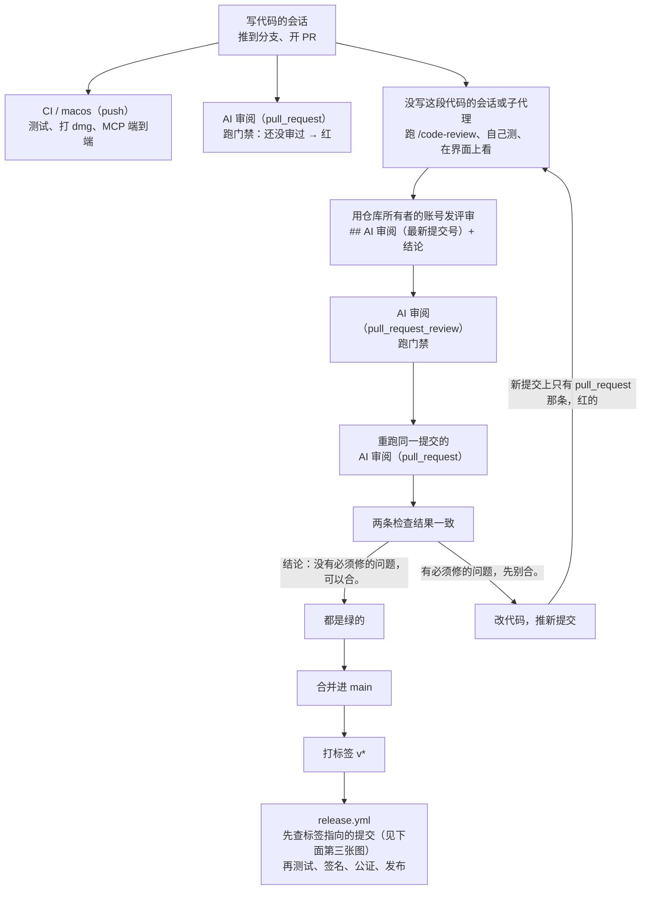
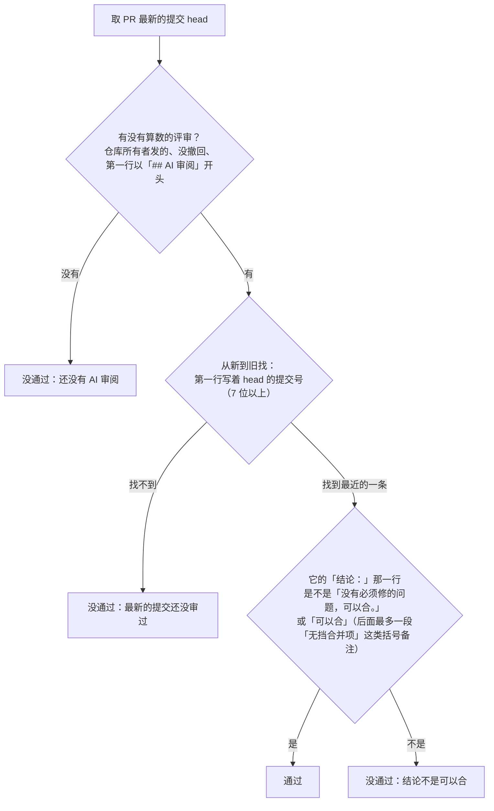
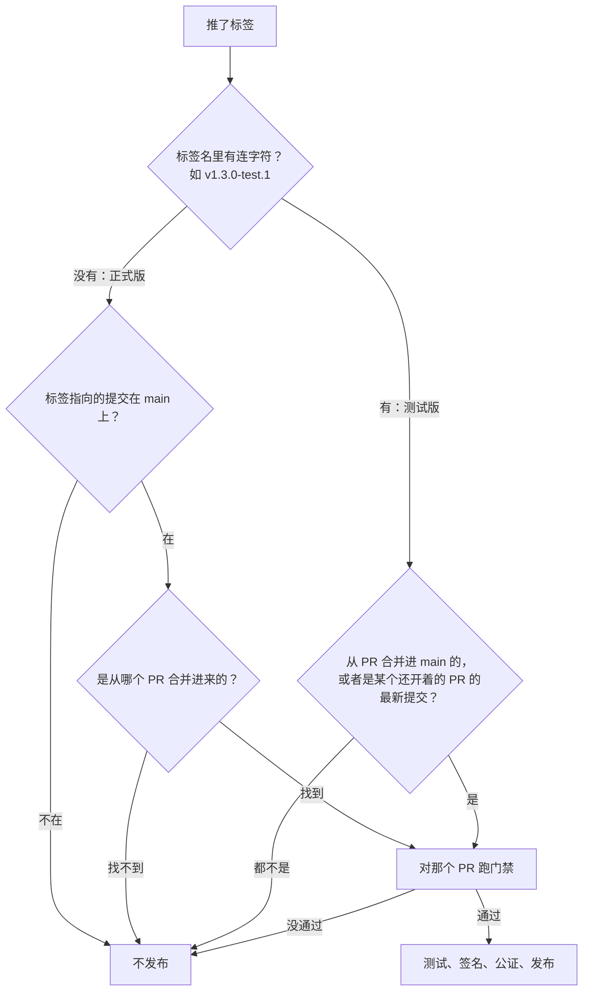

# AI 审阅流程图

[RELEASING.md「先过 AI 审阅」](../RELEASING.md#先过-ai-审阅)的图解：一个改动从开 PR 到发布，要经过哪几道检查。规则以 RELEASING.md 和 `scripts/ai_review_gate.py` 为准，改了流程记得同步改这里。

## 从开 PR 到发布

- 检查都在 PR 页面上：`CI / macos` 每次推送都跑；「AI 审阅」按触发它的事件列成两条，发审阅那次会顺手重跑开 PR 那次，两条跑完后是一样的颜色。重跑还没跑完、或者没重跑成功时会暂时不一样，看 pull_request_review 那次的日志。推了新提交，新提交上先只有 pull_request 那一条（红的），发了审阅才出现另一条。
- 合并按钮本身不等审阅（main 没有设分支保护）。真正拦住没审过的代码的是发布那一步：标签指向的提交没通过门禁，就不打包、不发布。
- 审完又推了提交，就要再审一次，标题写新的提交号，可以注明「增量」。

## 门禁怎么判断（`ai_review_gate.py pr <编号>`）

- 认两种结论：「没有必须修的问题，可以合。」（「的问题」可以省），和另一个审阅 agent 写的「可以合」加一段括号备注；「可以合并」也算。短的「可以合」后面不能再有别的字，括号备注只认「无挡合并项」「无必须修」「无 Must-fix」「无阻塞项」这几种（前面可以带「Comment；」，详见 RELEASING.md）。只看结论这一行，条件要写进结论行。「修完就可以合」「可以合，但……」「可以合（先修 X）」这类带条件的写法都算不通过。
- 几条评审都写着最新的提交号时只看最新的一条：后来的审阅说「先别合」，前面的「可以合」就不算了。
- 格式不对的评审（比如第一行是「## 审查结论」）不算数，但发出去照样会触发一次检查：最新提交还没有通过的审阅就是红的，已经有了就照样是绿的。

## 打标签发布时（`release.yml` 的第一步）

