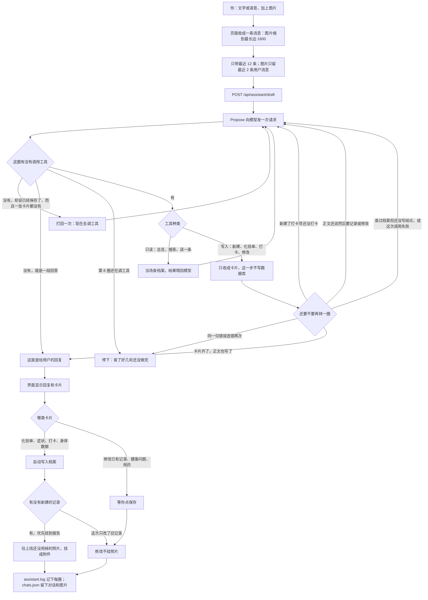

# AI 助手：发一张图、问一句话

一次发送从页面到档案的路径。循环在 `internal/assistant/draft.go` 的 `Propose`，卡片写入在 `commit.go`，照片在 `frontend/src/pages/Capture.tsx` 的 `pictureSource`。改了停轮、保存或挂图，记得同步改这张图。

一圈是一次发给模型的请求，最多 8 圈（`maxRounds`）。你再发一句，是另一次 `Propose`，从第 1 圈重新数。
